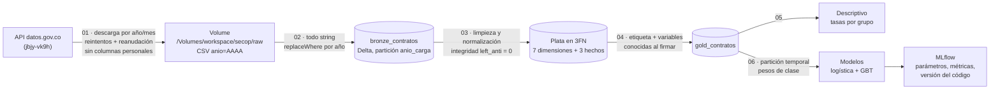
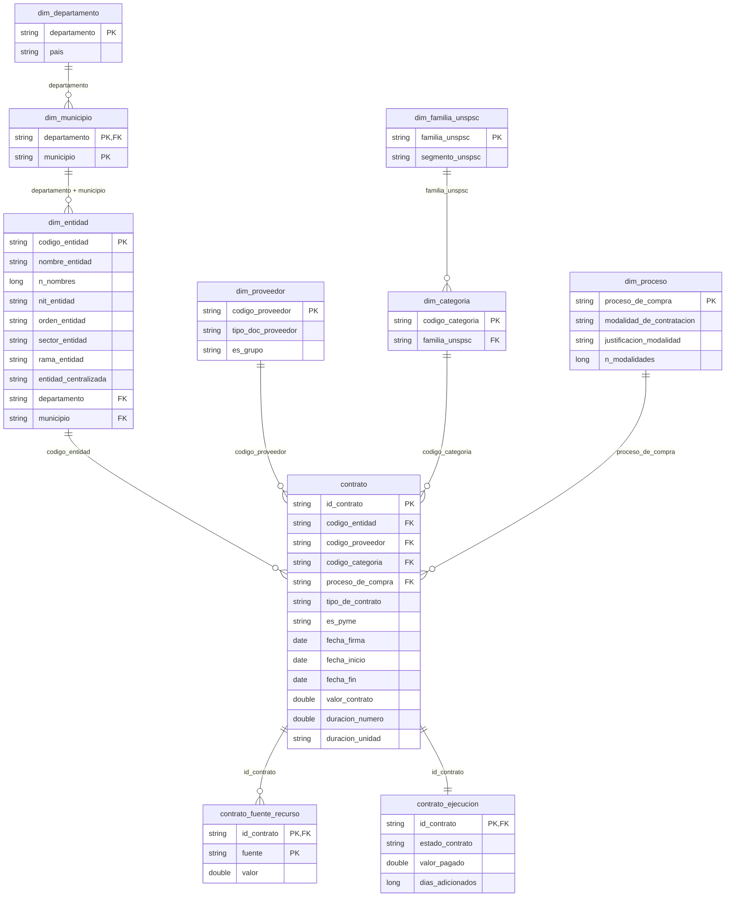

# Predicción de prórrogas en contratos SECOP II

[](https://github.com/CristianVallejo0104/proyecto-secop-databricks/actions/workflows/ci.yml)

Proyecto final de **Computación en la Nube** · Estadística · Universidad Santo Tomás (Bogotá).
Autores: Cristian (@CristianVallejo0104) y JP (@Juanxct).

## Propósito y pregunta

Cuando un contrato público recibe una **prórroga** (días añadidos a su plazo), es
señal de que no se cumplió en el tiempo planeado. Nuestra pregunta:

> Con la información disponible **al firmar** un contrato de SECOP II, ¿se le
> añadirán días después?

- **Etiqueta:** `dias_adicionados > 0` (en 2019, ~11 % de los contratos).
- **Datos:** "SECOP II - Contratos Electrónicos", API Socrata de datos.gov.co
  (id `jbjy-vk9h`), ~5,67 millones de filas y 95 columnas. Cargados: 2019 y 2020.
- **Objetivo del repositorio:** demostrar con calidad profesional las herramientas
  del curso: GitHub, Docker, Codespaces, reproducibilidad, almacenamiento en la nube,
  Spark/Databricks y Machine Learning con MLflow.

**Resultados: PENDIENTES** de ejecución en Databricks (ver [`docs/informe.md`](docs/informe.md)).
Este repositorio no contiene cifras de resultados inventadas.

## Arquitectura: bronce → plata → oro



| Capa | Qué contiene | Por qué |
|---|---|---|
| **Bronce** | Copia fiel de la fuente, todo texto, sin datos personales | Reprocesar sin volver a descargar (la API es lenta) |
| **Plata** | 10 tablas limpias en tercera forma normal (3FN) | Un dato en un solo lugar, sin redundancia; separar "al firmar" de "después" |
| **Oro** | Una fila por contrato con etiqueta y variables (desnormalizada a propósito) | Lista para el modelo y los descriptivos, sin repetir joins |

### Modelo entidad-relación (plata, 3FN)



**Formas normales** (detalle en [`docs/decisiones.md`](docs/decisiones.md) §3):

| Forma | Regla | Cómo se cumple |
|---|---|---|
| **1FN** | Valores atómicos, sin grupos repetidos | Localización separada en departamento y municipio; duración en número + unidad; las 6 columnas de fuentes pasan a filas (`contrato_fuente_recurso`) |
| **2FN** | Con llave compuesta, todo depende de la llave completa | `valor` depende de (contrato, fuente); el país no está en `dim_municipio` porque depende solo del departamento |
| **3FN** | Sin dependencias transitivas | Modalidad → `dim_proceso`; segmento → `dim_familia_unspsc`; país → `dim_departamento`; los días de duración (dato calculado) se calculan en oro |

Las dependencias funcionales que justifican el diseño (por ejemplo, "cada proceso
tiene una sola modalidad") **se comprueban con los datos** en el notebook 03
(`plata.revisar_dependencias`), y los tests verifican cada forma normal.

`contrato` solo tiene información disponible **al firmar**; todo lo posterior
(estado, pagos, saldos, días añadidos) está en `contrato_ejecucion` y nunca entra
al modelo, salvo `dias_adicionados` para construir la etiqueta.

## Estructura del repositorio

| Ruta | Contenido |
|---|---|
| `notebooks/01_descarga_exploracion.py` | Descarga reanudable, conteo contra el servidor, exploración |
| `notebooks/02_bronce.py` | CSV → Delta `bronze_contratos` |
| `notebooks/03_plata.py` | 10 tablas en 3FN, dependencias funcionales, llaves e integridad |
| `notebooks/04_oro.py` | `gold_contratos` con etiqueta |
| `notebooks/05_descriptivo.py` | Tasas de prórroga por grupo |
| `notebooks/06_modelo.py` | Modelos, métricas, prueba de fuga, MLflow, plan B |
| `src/secop/` | Toda la lógica, en funciones puras de PySpark |
| `tests/` | 84 pruebas con pytest sobre datos sintéticos |
| `scripts/validar_esquema.py` | Validación del esquema sin Spark (la usa Docker) |
| `scripts/simular_local.py` | Ejecuta los notebooks 02-06 en local con Delta y datos sintéticos |
| `docs/` | Decisiones, runbook, guion, preguntas, glosario, informe, flujo Git |

Los notebooks están en **formato fuente de Databricks** (`.py` con
`# Databricks notebook source`): se ven como notebooks en Databricks y como código
legible en GitHub, así los cambios se revisan bien en un pull request.

## Cómo ejecutar

### En Databricks (datos reales)

Resumen (el detalle y los errores previsibles están en
[`docs/runbook_databricks.md`](docs/runbook_databricks.md)):

1. Crear el esquema `workspace.secop` y el Volume `raw`.
2. Enlazar este repositorio como **Git folder**.
3. Ejecutar en orden `01` → `06`. Cada notebook es autocontenido (lee tablas, no
   variables de otro notebook) e importa `src/secop` añadiendo la raíz del repo a `sys.path`.

### En local o en Codespaces (datos sintéticos)

Requisitos: Python 3.12 y Java 17+ (Codespaces ya los trae configurados).

```bash
pip install -r requirements-dev.txt
```
```bash
make test
```
```bash
make lint
```
```bash
make docker
```

- `pip install ...`: instala las versiones exactas (`==`) de PySpark, pytest, ruff, etc.
- `make test`: ejecuta las pruebas con Spark local en modo ANSI (como serverless).
- `make lint`: revisa estilo y errores con ruff.
- `make docker`: construye la imagen y valida el esquema con datos sintéticos.

Opcional, para ejecutar los notebooks 02-06 completos en local:

```bash
pip install -r requirements-simulacion.txt
```
```bash
make simular
```

## Herramientas del curso y por qué

| Herramienta | Uso en el proyecto | Por qué |
|---|---|---|
| **GitHub** | Ramas `trabajo/*`, PR con plantilla, commits específicos, regla de oro "pull antes de push" ([`docs/flujo_git.md`](docs/flujo_git.md)) | Trabajo en pareja sin pisarse; historial auditable |
| **GitHub Actions** | `py_compile`, ruff, validación de esquema, pytest y Docker en cada push y PR | Detectar errores antes de llegar a `main` |
| **Docker** | Imagen `python:3.12-slim` que valida el esquema | Mismo resultado en cualquier máquina |
| **Codespaces** | `.devcontainer/devcontainer.json` con Python 3.12 y Java 17 | Entorno listo en un clic, igual para los dos |
| **Reproducibilidad** | Versiones con `==`, semilla 42, versión del código en MLflow, etiquetas de git | Poder repetir exactamente cada resultado |
| **Almacenamiento en la nube** | Volume de Unity Catalog + tablas Delta | Transacciones, historial (*time travel*), recarga por partición |
| **Spark / Databricks** | Todas las transformaciones en PySpark sobre serverless | Procesamiento distribuido de millones de filas |
| **MLflow** | Un run por variante y algoritmo con parámetros, métricas y commit | Comparar modelos y saber con qué código se obtuvo cada uno |

## Decisiones clave

Explicadas en [`docs/decisiones.md`](docs/decisiones.md):

- **Datos personales** eliminados antes de la primera tabla; la descarga ni siquiera
  los pide (`$select`). Lista única en `src/secop/esquema.py`.
- **Sin fuga de información:** solo variables conocidas al firmar. El plazo
  (fin − inicio) es dudoso, así que se prueba aparte (con y sin plazo).
- **Partición temporal**, pesos de clase y métricas AUC-ROC, AUC-PR y F1.
- **2025-2026 no se usan para entrenar:** su etiqueta aún puede cambiar.
- **Serverless:** sin `cache`/`persist`/RDD/`sparkContext`; `try_cast` por el modo ANSI;
  nada de `toPandas()` sobre tablas grandes; plan B con scikit-learn sobre una muestra.
- **Cambiar de base de datos** implica tocar sobre todo `esquema.py` y `config.py`.

## Qué está probado y qué no

| Componente | Estado |
|---|---|
| Funciones de `src/secop` (limpieza, plata, oro, métricas, pipelines) | ✅ 84 pruebas pytest con Spark 4.0.1 local en modo ANSI, datos sintéticos |
| Notebooks 02 a 06 de punta a punta | ✅ Ejecutados en local con Delta y datos sintéticos (`make simular`), con MLlib y con el plan B |
| Validación de esquema y estilo | ✅ `scripts/validar_esquema.py`, ruff y py_compile |
| Notebook 01 (descarga desde la API) | ⚠️ Solo revisado; no se ejecutó (no hay acceso a la API desde el entorno de desarrollo) |
| Ejecución en Databricks serverless con datos reales | ❌ PENDIENTE: la deben hacer los autores |
| Imagen Docker | ✅ Construida y ejecutada en el entorno de desarrollo; también en CI |
| Resultados (descriptivos y métricas) | ❌ PENDIENTES |

Detalle de la revisión final: [`docs/lista_de_revision.md`](docs/lista_de_revision.md).

## Documentación

- [`docs/runbook_databricks.md`](docs/runbook_databricks.md): paso a paso y errores previsibles.
- [`docs/decisiones.md`](docs/decisiones.md): por qué cada decisión.
- [`docs/guion_sustentacion.md`](docs/guion_sustentacion.md): guion de 5 minutos a dos voces.
- [`docs/preguntas_probables.md`](docs/preguntas_probables.md): preguntas del profesor y respuestas.
- [`docs/glosario.md`](docs/glosario.md): términos clave.
- [`docs/informe.md`](docs/informe.md): informe con resultados PENDIENTES.
- [`docs/flujo_git.md`](docs/flujo_git.md): ramas, commits, regla de oro y etiquetas.
