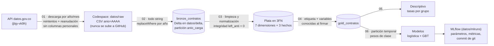
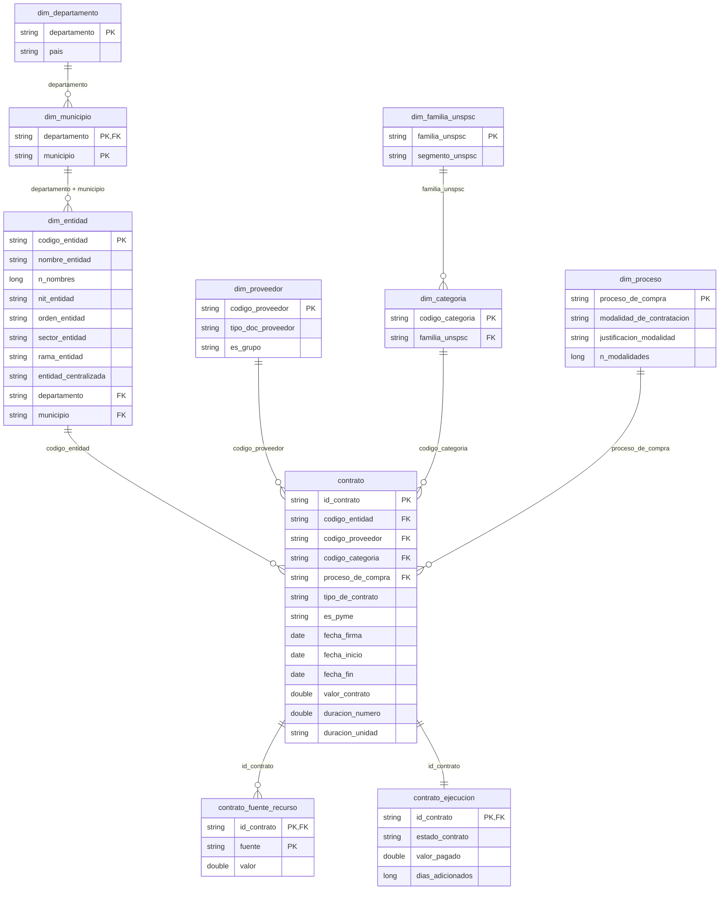

# Predicción de prórrogas en contratos SECOP II

[](https://github.com/CristianVallejo0104/proyecto-secop-databricks/actions/workflows/ci.yml)

Proyecto final de **Computación en la Nube** · Estadística · Universidad Santo Tomás (Bogotá).
Autores: Cristian (@CristianVallejo0104) y JP (@Juanxct).

## Propósito y pregunta

Cuando un contrato público recibe una **prórroga** (días añadidos a su plazo), es
señal de que no se cumplió en el tiempo planeado. Nuestra pregunta:

> Con la información disponible **al firmar** un contrato de SECOP II, ¿se le
> añadirán días después?

- **Etiqueta:** `dias_adicionados > 0` (en 2019, ~11 % de los contratos).
- **Datos:** "SECOP II - Contratos Electrónicos", API Socrata de datos.gov.co
  (id `jbjy-vk9h`), ~5,67 millones de filas y 95 columnas. Años previstos: 2019 y 2020.
- **Objetivo del repositorio:** demostrar con calidad profesional las herramientas
  del curso: GitHub, Docker, Codespaces, reproducibilidad, almacenamiento con tablas
  Delta, Spark (PySpark) y Machine Learning con MLflow.
- **Dónde corre:** todo en Python dentro de **GitHub Codespaces**, con Spark en modo
  local, tablas Delta y MLflow. Los pasos son notebooks de Jupyter.

**Resultados: PENDIENTES** de ejecución con los datos reales (ver [`docs/informe.md`](docs/informe.md)).
Este repositorio no contiene cifras de resultados inventadas.

## Contenido

1. [Estado del proyecto](#estado-del-proyecto)
2. [Qué falta: guía paso a paso](#qué-falta-guía-paso-a-paso)
3. [Arquitectura: bronce → plata → oro](#arquitectura-bronce--plata--oro)
4. [Estructura del repositorio](#estructura-del-repositorio)
5. [Cómo ejecutar](#cómo-ejecutar)
6. [Herramientas del curso y por qué](#herramientas-del-curso-y-por-qué)
7. [Decisiones clave](#decisiones-clave)
8. [Qué está probado y qué no](#qué-está-probado-y-qué-no)
9. [Documentación](#documentación)

## Estado del proyecto

| Parte | Estado |
|---|---|
| Código (`src/secop/`), notebooks 01-06, tests, Docker, Codespaces, CI | ✅ Terminado |
| Pipeline completo probado con datos **sintéticos** (en local y en la CI) | ✅ Corre sin errores |
| Documentación (decisiones, runbook, guion, preguntas, glosario) | ✅ Terminada |
| Ejecución con los datos **reales** de SECOP | ⏳ Pendiente: hay que hacerla en el Codespace |
| Resultados en `docs/informe.md` y en el guion | ⏳ Pendientes: dependen de la ejecución real |

¿Por qué falta la ejecución real? Los datos se descargan de la API de datos.gov.co, y
eso solo se puede hacer desde un entorno con internet abierto como el Codespace. Las
pruebas con datos sintéticos garantizan que el código corre; los números reales salen
al ejecutar `make pipeline`.

## Qué falta: guía paso a paso

Tiempo estimado: unas pocas horas, casi todo esperando la descarga y el modelo.
Detalle y solución de errores en [`docs/runbook.md`](docs/runbook.md).

**1. Crear el Codespace** (una vez por persona). En GitHub: botón verde **Code** →
**Codespaces** → **⋯** → **New with options** → rama `main` → máquina **4-core** →
**Create codespace**. Se instala todo solo (Python 3.12, Java 17, librerías).

**2. Comprobar que todo funciona** (en la terminal del Codespace):

```bash
make test
```
```bash
make notebooks-prueba
```

El primero corre las pruebas y el segundo ejecuta los notebooks con datos inventados.
Ambos deben terminar sin errores.

**3. Borrar los datos viejos de Databricks.** Si todavía existen los CSV o tablas de la
descarga anterior en Databricks, bórralos allá: tienen las columnas con datos
personales. La descarga nueva no las pide.

**4. Ejecutar el pipeline con los datos reales:**

```bash
make pipeline
```

Descarga 2019 y 2020 de la API (reanuda si se corta), construye bronce, plata y oro,
calcula los descriptivos y entrena los modelos. Las copias con resultados quedan en
`datos/ejecutados/` (se abren en VS Code). Si algo falla, el runbook tiene la tabla de
errores y soluciones.

**5. Revisar los resultados:** abrir los notebooks de `datos/ejecutados/` y la interfaz
de MLflow:

```bash
make mlflow
```

**6. Copiar los resultados a la documentación**, en una rama nueva:

```bash
git switch -c trabajo/resultados
```

Editar `docs/informe.md` (cada `PENDIENTE`) y los marcadores `[PENDIENTE: ...]` de
`docs/guion_sustentacion.md` con los números reales. Luego, commit específico y la
regla de oro (pull antes de push):

```bash
git add docs/informe.md docs/guion_sustentacion.md
```
```bash
git commit -m "Informe: resultados reales de 2019-2020 (descriptivos y modelo)"
```
```bash
git pull --rebase origin main
```
```bash
git push -u origin trabajo/resultados
```

**7. Pull request y revisión:** en GitHub, abrir el PR de `trabajo/resultados` hacia
`main`; que el compañero lo revise y apruebe; esperar la CI en verde; **Merge**.

**8. Etiqueta de versión** (desde `main` actualizado):

```bash
git switch main
```
```bash
git pull origin main
```
```bash
git tag -a v0.1 -m "v0.1: pipeline ejecutado con datos reales"
```
```bash
git push origin v0.1
```

**9. Ensayar la sustentación** con [`docs/guion_sustentacion.md`](docs/guion_sustentacion.md)
y [`docs/preguntas_probables.md`](docs/preguntas_probables.md). Al terminar, **detener el
Codespace** para no gastar horas gratuitas (detenerlo no borra nada; eliminarlo sí borra
`datos/`).

> Antes de cada commit con notebooks: **Clear All Outputs** en VS Code. La CI falla si un
> notebook se sube con resultados (así nunca llegan datos reales a GitHub).

## Arquitectura: bronce → plata → oro



| Capa | Qué contiene | Por qué |
|---|---|---|
| **Bronce** | Copia fiel de la fuente, todo texto, sin datos personales | Reprocesar sin volver a descargar (la API es lenta) |
| **Plata** | 10 tablas limpias en tercera forma normal (3FN) | Un dato en un solo lugar, sin redundancia; separar "al firmar" de "después" |
| **Oro** | Una fila por contrato con etiqueta y variables (desnormalizada a propósito) | Lista para el modelo y los descriptivos, sin repetir joins |

### Modelo entidad-relación (plata, 3FN)



**Formas normales** (detalle en [`docs/decisiones.md`](docs/decisiones.md) §3):

| Forma | Regla | Cómo se cumple |
|---|---|---|
| **1FN** | Valores atómicos, sin grupos repetidos | Localización separada en departamento y municipio; duración en número + unidad; las 6 columnas de fuentes pasan a filas (`contrato_fuente_recurso`) |
| **2FN** | Con llave compuesta, todo depende de la llave completa | `valor` depende de (contrato, fuente); el país no está en `dim_municipio` porque depende solo del departamento |
| **3FN** | Sin dependencias transitivas | Modalidad → `dim_proceso`; segmento → `dim_familia_unspsc`; país → `dim_departamento`; los días de duración (dato calculado) se calculan en oro |

Las dependencias funcionales que justifican el diseño (por ejemplo, "cada proceso
tiene una sola modalidad") **se comprueban con los datos** en el notebook 03
(`plata.revisar_dependencias`), y los tests verifican cada forma normal.

`contrato` solo tiene información disponible **al firmar**; todo lo posterior
(estado, pagos, saldos, días añadidos) está en `contrato_ejecucion` y nunca entra
al modelo, salvo `dias_adicionados` para construir la etiqueta.

## Estructura del repositorio

| Ruta | Contenido |
|---|---|
| `notebooks/01_descarga_exploracion.ipynb` | Descarga reanudable, conteo contra el servidor, exploración |
| `notebooks/02_bronce.ipynb` | CSV → Delta `bronze_contratos` |
| `notebooks/03_plata.ipynb` | 10 tablas en 3FN, dependencias funcionales, llaves e integridad |
| `notebooks/04_oro.ipynb` | `gold_contratos` con etiqueta |
| `notebooks/05_descriptivo.ipynb` | Tasas de prórroga por grupo, con tablas y gráficos |
| `notebooks/06_modelo.ipynb` | Modelos, métricas, prueba de fuga, MLflow, plan B |
| `src/secop/` | Toda la lógica, en funciones puras de PySpark (`entorno.py` crea Spark, lee y escribe Delta) |
| `tests/` | 111 pruebas con pytest sobre datos sintéticos |
| `scripts/ejecutar_notebooks.py` | Ejecuta los notebooks en orden (datos reales o sintéticos) |
| `scripts/validar_esquema.py` | Validación del esquema sin Spark (la usa Docker) |
| `docs/` | Decisiones, runbook, guion, preguntas, glosario, informe, flujo Git |
| `datos/` | **No está en GitHub.** Se crea al ejecutar: CSV, tablas Delta, MLflow |

Los notebooks se suben **sin salidas** (un test lo exige): así ningún dato real
termina en GitHub y los cambios se revisan bien en un pull request.

## Cómo ejecutar

El paso a paso completo y los errores previsibles están en
[`docs/runbook.md`](docs/runbook.md). Resumen:

1. En GitHub: **Code** → **Codespaces** → crear un Codespace (mejor de 4 núcleos para
   los datos reales). Se instala todo solo: Python 3.12, Java 17 y las librerías.
2. En la terminal del Codespace:

```bash
make test
```
```bash
make notebooks-prueba
```
```bash
make pipeline
```
```bash
make mlflow
```

- `make test`: ejecuta las pruebas con Spark local en modo ANSI.
- `make notebooks-prueba`: ejecuta los notebooks 02-06 con datos **sintéticos** (5 minutos), sin tocar `datos/`.
- `make pipeline`: ejecuta los notebooks 01-06 con los datos **reales** (descarga lo que falte de la API) y guarda copias con resultados en `datos/ejecutados/`.
- `make mlflow`: abre la interfaz de MLflow en el puerto 5000 para comparar los modelos.

También se puede abrir cada notebook en VS Code y pulsar **Run All**, en orden de
01 a 06. Cada uno es autocontenido: lee tablas de `datos/`, no variables de otro notebook.

## Herramientas del curso y por qué

| Herramienta | Uso en el proyecto | Por qué |
|---|---|---|
| **GitHub** | Ramas `trabajo/*`, PR con plantilla, commits específicos, regla de oro "pull antes de push" ([`docs/flujo_git.md`](docs/flujo_git.md)) | Trabajo en pareja sin pisarse; historial auditable |
| **GitHub Actions** | `py_compile`, ruff, validación de esquema, pytest, **ejecución de los notebooks con datos sintéticos** y Docker en cada push y PR | Detectar errores antes de llegar a `main` |
| **Docker** | Imagen `python:3.12-slim` que valida el esquema | Mismo resultado en cualquier máquina |
| **Codespaces** | Máquina en la nube donde se ejecuta todo; `.devcontainer/devcontainer.json` instala Python 3.12, Java 17 y las librerías | Entorno idéntico para los dos; programar, probar y ejecutar en el mismo lugar |
| **Reproducibilidad** | Versiones con `==`, semilla 42, versión del código en MLflow, etiquetas de git | Poder repetir exactamente cada resultado |
| **Almacenamiento** | Tablas Delta en el Codespace (`datos/delta/`) | Transacciones, historial (*time travel*), recarga por partición |
| **Spark (PySpark)** | Todas las transformaciones en PySpark, Spark en modo local | Procesamiento en paralelo; el mismo código correría en un clúster |
| **Jupyter** | Los 6 pasos son notebooks `.ipynb` con explicaciones | Mostrar el proceso paso a paso en la sustentación |
| **MLflow** | Un run por variante y algoritmo con parámetros, métricas y commit | Comparar modelos y saber con qué código se obtuvo cada uno |

## Decisiones clave

Explicadas en [`docs/decisiones.md`](docs/decisiones.md):

- **Datos personales** eliminados antes de la primera tabla; la descarga ni siquiera
  los pide (`$select`). Lista única en `src/secop/esquema.py`.
- **Sin fuga de información:** solo variables conocidas al firmar. El plazo
  (fin − inicio) es dudoso, así que se prueba aparte (con y sin plazo).
- **Partición temporal**, pesos de clase y métricas AUC-ROC, AUC-PR y F1.
- **2025-2026 no se usan para entrenar:** su etiqueta aún puede cambiar.
- **Codespaces y no Databricks:** el mismo PySpark en modo local alcanza para unos 500
  mil contratos, y todo queda en el mismo lugar que el código (ver decisiones §10).
- **Memoria:** `try_cast` por el modo ANSI; nada de `toPandas()` sobre tablas grandes;
  plan B con scikit-learn sobre una muestra.
- **Cambiar de base de datos** implica tocar sobre todo `esquema.py` y `config.py`.

## Qué está probado y qué no

| Componente | Estado |
|---|---|
| Funciones de `src/secop` (limpieza, plata, oro, descarga, métricas, pipelines, gráficos) | ✅ 111 pruebas pytest con Spark 4.0.1 local en modo ANSI, datos sintéticos |
| Notebooks 02 a 06 (`.ipynb`) de punta a punta | ✅ Ejecutados con Jupyter, Delta y datos sintéticos (`make notebooks-prueba`); también en la CI |
| Lógica de descarga (reintentos, reanudación, sin columnas personales) | ✅ Probada con una API falsa, sin internet |
| Validación de esquema y estilo | ✅ `scripts/validar_esquema.py`, ruff y py_compile |
| Notebook 01 contra la API real | ⚠️ No se ejecutó (no hay acceso a la API desde el entorno de desarrollo) |
| Ejecución con datos reales en el Codespace | ❌ PENDIENTE: la deben hacer los autores (`make pipeline`) |
| Imagen Docker | ✅ Construida y ejecutada en el entorno de desarrollo; también en CI |
| Resultados (descriptivos y métricas) | ❌ PENDIENTES |

Detalle de la revisión final: [`docs/lista_de_revision.md`](docs/lista_de_revision.md).

## Documentación

- [`docs/runbook.md`](docs/runbook.md): paso a paso en Codespaces y errores previsibles.
- [`docs/decisiones.md`](docs/decisiones.md): por qué cada decisión.
- [`docs/guion_sustentacion.md`](docs/guion_sustentacion.md): guion de 5 minutos a dos voces.
- [`docs/preguntas_probables.md`](docs/preguntas_probables.md): preguntas del profesor y respuestas.
- [`docs/glosario.md`](docs/glosario.md): términos clave.
- [`docs/informe.md`](docs/informe.md): informe con resultados PENDIENTES.
- [`docs/flujo_git.md`](docs/flujo_git.md): ramas, commits, regla de oro y etiquetas.
